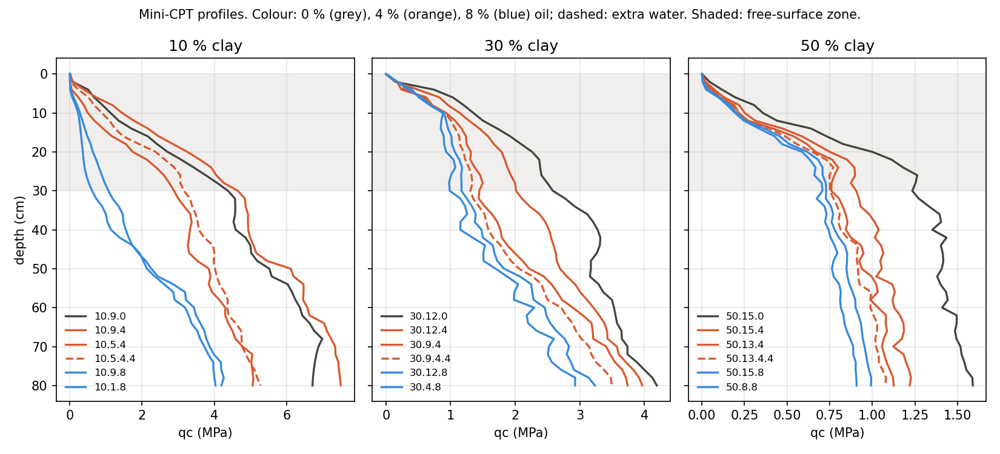
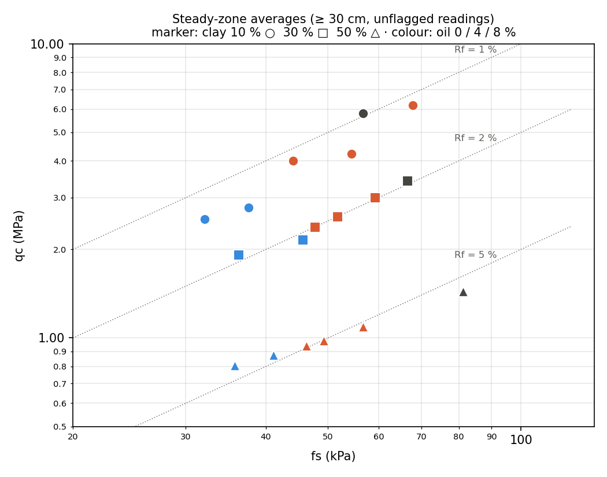

# minicpt-fair-benchmark

**From lab notebook to FAIR dataset: re-engineering my MSc mini-CPT campaign,
and carrying the lessons over to GPR utility surveys.**

In 2017–2018 I built and commissioned a laboratory mini-CPT rig at Amirkabir
University of Technology and ran 18 tests on sand–kaolinite mixtures
contaminated with crude oil (MSc thesis, 2019). Eight years later I reopened the
data and found that I could not reproduce my own results table: the processing
had never been documented.

This repository turns the surviving data into a documented, reproducible
dataset, with provenance for every value, schema-validated metadata and
automated quality control. It then writes down, as a protocol, what should have
been recorded — and transfers that design to metadata for GPR survey lines.



## What the reprocessing revealed

1. **The data-entry method changed between test series, undocumented.** Reading
   the spreadsheet formulas, not just the values, showed that sleeve force was
   *derived* (total − tip) in most 10 % clay tests, total force was derived
   (tip + sleeve) in the 30 % and 50 % clay tests, and in test **30.12.8** all
   three forces were typed by hand — which is why it is the only test where
   total ≠ tip + sleeve (13 readings, QC status FAIL).
2. **Subtraction amplifies sensor error.** Where sleeve force was derived from
   two large, similar forces near the surface, the result can be negative
   (−0.48 N at 2 cm in test 10.9.0).
3. **The first ~30 cm are a free-surface zone.** qc rises steeply over about
   12 cone diameters before stabilising; the overburden stress at 80 cm is only
   ≈ 0.014 MPa, so this rise is not caused by depth stress. Averages here use
   readings ≥ 30 cm only.
4. **The thesis Table 5-2 cannot be fully reproduced.** Its qc values are
   consistent with the full-depth mean tip force divided by ≈ 8.2 cm², not the
   4.52 cm² of the 24 mm cone; its fs values follow no single rule tested. See
   [`reports/qc_report.md`](reports/qc_report.md).
5. **Each condition was tested once**, so repeatability cannot be estimated.

The physics of the thesis still holds — oil reduced sleeve friction more than
tip resistance, increasingly with clay content — but its numbers are only as
trustworthy as their undocumented processing.



## Repository structure

| Folder | Contents |
| --- | --- |
| `data/raw/` | Original workbooks extracted from the thesis, never edited, with SHA-256 checksums in `MANIFEST.csv` |
| `data/reference/` | Values transcribed from the thesis, for comparison |
| `data/processed/` | Generated by the scripts: tidy forces, qc/fs/Rf with flags, per-test summary |
| `metadata/` | `campaign.json` (shared by all tests), `schema/` (rules every record must pass), `tests/` (one record per test) |
| `reports/` | QC report and figures |
| `docs/` | [Measurement protocol](docs/measurement_protocol.md), [data management plan](docs/data_management_plan.md), [draft GPR line schema](docs/gpr_line.schema.json) with an [example](docs/gpr_line.example.json) |
| `src/` | Python scripts, run in the order below |

## How to reproduce

```bash
python -m venv .venv
.venv\Scripts\activate          # Windows; on Linux/macOS: source .venv/bin/activate
python -m pip install -r requirements.txt

python src/extract_raw.py path/to/thesis.docx   # only needed once; raw files are already in data/raw
python src/build_tidy.py        # tidy table with cell-level provenance
python src/build_metadata.py    # per-test metadata, validated against the schema
python src/run_qc.py            # qc, fs, Rf, quality flags, QC report
python src/make_figures.py      # figures
```

## Data

18 mini-CPT tests: three mixtures (10, 30, 50 % kaolinite with silica sands 141
and 191), 0, 4 and 8 % crude oil, cone Ø 24 mm, sleeve 90 mm, penetration
20 mm/s to 80 cm, one reading per 2 cm. Test codes read
`clay.moisture.oil[.extra water]`, all in percent, moisture gravimetric.

## From CPT to GPR

The same design carries over to GPR benchmark surveys: metadata on three levels
(campaign → survey day → line), ground conditions (volumetric moisture,
conductivity, temperature) recorded per survey because they control wave
velocity and attenuation, raw radargrams kept unchanged with checksums, repeated
lines to quantify repeatability, and known pipe positions as ground truth. The
GPR schema in `docs/` is a draft and has not been tested on real survey data.

## Citation and licence

Ghalenoee, M. (2019). *Using CPT data in contaminated soil behavior
classification.* MSc thesis, Amirkabir University of Technology, Tehran
(supervisor: Dr. A. Eslami).

Code: MIT. Data and documentation: CC BY 4.0.
